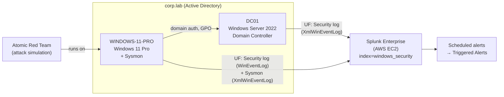
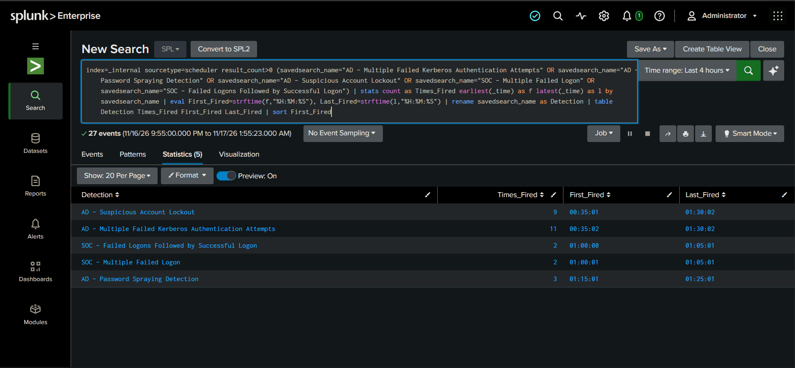
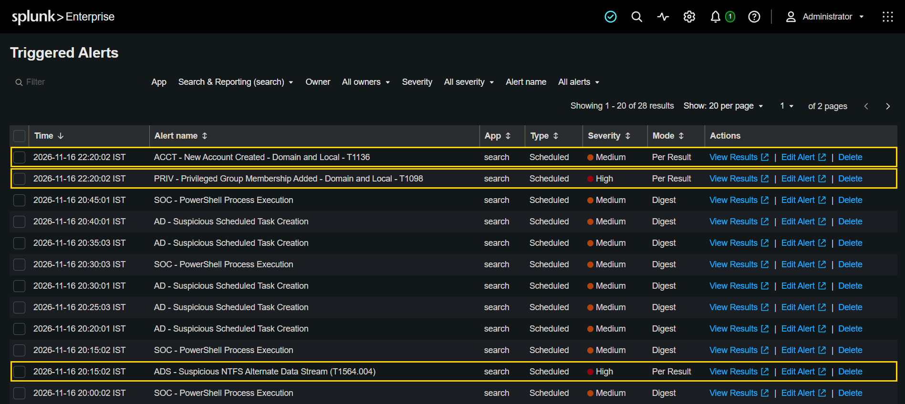
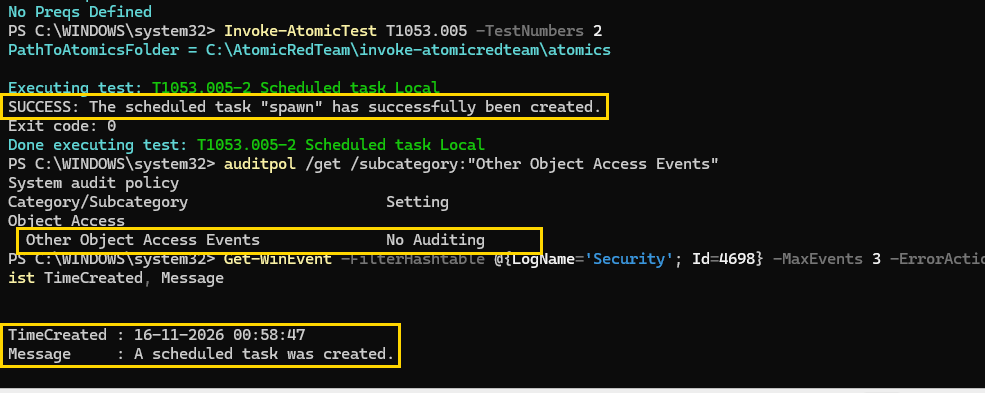

# Active Directory SOC Detection Lab

> I built a small Active Directory environment, forwarded its logs to Splunk, wrote detections mapped to MITRE ATT&CK, then **attacked my own lab with Atomic Red Team to prove each detection actually fires** — and fixed the gaps those tests exposed.

**What makes this project different:** it's not just a set of SPL queries. Every detection marked ✅ below was validated by a real attack simulation, with timestamped evidence from Splunk. Three of those tests revealed real problems — a silently disabled audit policy, duplicate alerting, and alerts that were blind to half the environment — and each one was diagnosed, fixed, and re-tested.

---

## At a glance

| | |
|---|---|
| **Domain** | `corp.lab` — 1 domain controller (Windows Server 2022), 1 domain-joined Windows 11 Pro workstation |
| **SIEM** | Splunk Enterprise 10.6 on AWS EC2, Universal Forwarders on both hosts |
| **Telemetry** | Windows Security log (both hosts), Sysmon (workstation) |
| **Attack simulation** | Atomic Red Team (Invoke-AtomicRedTeam) |
| **Detections validated** | 9 end-to-end (attack → log → alert), across 2 hosts and 2 log formats |
| **Gaps found** | 5 — 4 fixed, plus 1 scoping insight — see [Findings](#findings-what-the-attacks-revealed) |

---

## Architecture

Full build details: [`active-directory/`](active-directory/README.md)

---

## Detection results

### ✅ Validated end-to-end

| Detection | MITRE ATT&CK | Atomic test(s) | Hosts covered | Result |
|---|---|---|---|---|
| [Suspicious NTFS Alternate Data Stream](detections/T1564.004-ntfs-ads/) | T1564.004 (exec via T1059.001) | T1059.001-11 | Workstation | Fired, **High** — 0 false positives against 24h baseline |
| [Scheduled Task Creation](detections/T1053.005-scheduled-task/) | T1053.005 | T1053.005-2 (`schtasks.exe`), T1053.005-4 (PowerShell cmdlets) | Workstation | Fired for **both** creation methods |
| [New Account Created — Domain & Local](detections/T1136-account-created/) | T1136.001, T1136.002 | T1136.002-1, T1136.001-8 | DC + Workstation | Fired for **both** in one run |
| [Privileged Group Membership Added](detections/T1098-privileged-group-added/) | T1098 | Same runs as above — each test also adds the new account to a privileged group | DC + Workstation | Domain Admins → **Critical**, local Administrators → **High** |
| [Multiple Failed Kerberos Auth](detections/T1110.001-kerberos-brute-force/) | T1110.001 | Manual + T1110.001-1 (`user=soc.testuser`) | DC01 | Fired on 5× 4771 `0x18` |
| [Password Spraying](detections/T1110.003-password-spraying/) | T1110.003 | T1110.003-1 | DC01 | Fired on 6 distinct accounts from one source |
| [Suspicious Account Lockout](detections/T1110-account-lockout/) | T1110 | Manual + T1110.001-1 | DC01 | Fired on 4740, mapped to source |
| [Multiple Failed Logon (endpoint)](detections/T1110-failed-logon-endpoint/) | T1110 | Manual `LogonUser` | Workstation | Fired on 5× local 4625 |
| [Failed → Successful Logon](detections/T1110-failed-then-successful-logon/) | T1110 | Manual `LogonUser` | Workstation | Fired on 5 fails + 1 success in one bin |

> **Why two of these used a manual simulation instead of an atomic:** the endpoint logon rules read **4625 on the workstation**, but standard T1110 atomics authenticate against the **DC** (Kerberos → 4771) and never produce that event. Recognising that and validating with a `LogonUser` local logon is [finding 4](findings/04-endpoint-alerts-not-art-drivable.md).

*All five credential-access detections firing, by scheduler count and time.*

### 🔄 Built, validation pending
Encoded PowerShell (T1059.001 — tested in an earlier session; re-validation with evidence planned) · Scheduled-task coverage on DC01. See [roadmap](docs/roadmap.md).

*The new combined alerts (ACCT, PRIV) and the ADS alert firing in Splunk's Triggered Alerts.*

---

## Findings: what the attacks revealed

These are the most important part of the project. Each one is a problem that **only showed up because I tested the detections** instead of assuming they worked.

### 1. A Group Policy refresh was silently disabling audit logging → [details](findings/01-audit-policy-reset-by-gpo.md)
The scheduled-task attack ran, Sysmon recorded it — but **no Event 4698 was written**, so the alert never fired. Root cause: local audit settings were being reset by Group Policy on every refresh. Fixed centrally in GPO and verified on **both** hosts after `gpupdate /force`.

### 2. Overlapping search windows caused duplicate alerts → [details](findings/02-duplicate-alerts-window-overlap.md)
Alerts ran every 5 minutes but searched the last 15, so one malicious event fired **up to 3 times**. A hidden `earliest=-15m` inside the SPL was overriding the alert's own time range. Fixed by aligning windows to `-5m@m` → `@m`.

### 3. Two log formats meant each alert set saw only half the environment → [details](findings/03-split-log-formats-blind-alerts.md)
The DC sends XML-formatted events, the workstation sends classic events. My "AD" alerts only parsed XML; my "SOC" alerts only parsed classic. **Each missed one machine.** A domain-admin creation on the DC went undetected by one set; a local-admin creation on the workstation by the other. Replaced both pairs with format-agnostic alerts and proved coverage of both hosts in a single run.

| Attack | Old "AD" alerts | Old "SOC" alerts | **New combined alerts** |
|---|---|---|---|
| Domain admin created on DC01 | ✅ | ❌ missed | ✅ |
| Local admin created on workstation | ❌ missed | ✅ | ✅ |

### 4. Two endpoint alerts couldn't be driven by standard brute-force atomics → [details](findings/04-endpoint-alerts-not-art-drivable.md)
The `SOC - Multiple Failed Logon` and `SOC - Failed → Successful Logon` rules read **4625 on the workstation**. Every T1110 atomic I tried produced **nothing** there — because `net use` by hostname uses **Kerberos**, which fails at the **DC** (4771), so the workstation never logs the attempt. The rules were correct; the *validation method* was wrong. I drove them instead with a direct `LogonUser` local logon, which forces the attempt through the endpoint's own LSA. Knowing which of 4771 / 4776 / 4625 each auth protocol writes — and on which host — is what made these validations honest.

### 5. The AD threshold alerts had no throttling → [details](findings/05-ad-alerts-no-throttling.md)
Finding 2's design rule said threshold alerts should control duplicates with **throttling** — but the scheduler history showed the three AD alerts never had `alert.suppress` set. One password-spray test raised **3** alerts; one brute-force burst raised **up to 8**. The two SOC logon alerts (which *do* carry a 10-minute suppression) each fired once. **Fixed 2026-11-17** — `alert.suppress` applied to all three AD alerts, keyed to `TargetUserName` (brute force/lockout) or `IpAddress` (spray); after-test confirmed (one fire per incident).

---

## How to explore this repo

| Folder | What's inside |
|---|---|
| [`active-directory/`](active-directory/) | Domain design: OUs, users, GPOs and where they're linked, audit policy |
| [`detections/`](detections/) | One folder per detection: SPL, metadata (YAML), validation write-up |
| [`findings/`](findings/) | The three gaps: symptom → root cause → fix → verification |
| [`atomic-tests/`](atomic-tests/) | Timestamped log of every attack run and cleanup |
| [`evidence/`](evidence/) | All screenshots referenced in the write-ups |
| [`docs/demo-script.md`](docs/demo-script.md) | 5-minute walkthrough for presenting this project |
| [`docs/roadmap.md`](docs/roadmap.md) | What's next, including known noisy alerts |

---

## Skills demonstrated

- **Active Directory administration** — OU design, user provisioning, Group Policy creation/linking, advanced audit policy
- **SIEM engineering (Splunk)** — Universal Forwarder deployment, SPL with `rex`/`eval`/`coalesce`, scheduled alerts, throttling, alert-window design
- **Detection engineering** — baselining normal activity before writing rules, MITRE ATT&CK mapping, severity tiering, false-positive control
- **Detection validation** — adversary emulation with Atomic Red Team, evidence-based verification, safe cleanup
- **Troubleshooting** — tracing a missing alert back through Splunk → Windows Event Log → `auditpol` → Group Policy

---

## Safety notes
All attacks ran in an isolated lab. Every Atomic test was cleaned up and verified (e.g. test admin accounts confirmed deleted with `net user`). No credentials, keys, or public IPs are included in this repository; security identifiers in screenshots are partially redacted.
