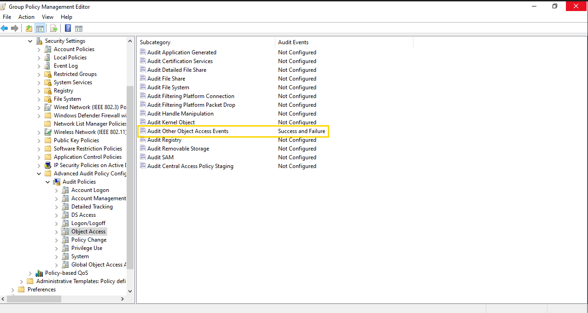
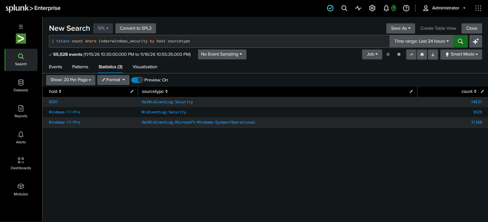

# Active Directory Build — `corp.lab`

## Domain

| Property | Value |
|---|---|
| Domain (DNS) | `corp.lab` (NetBIOS: `CORP`) |
| Functional level | Windows Server 2016 (`Windows2016Domain`) |
| Domain controller | `DC01.corp.lab` — Windows Server 2022, holds the PDC Emulator role |
| Member workstation | `WINDOWS-11-PRO` — Windows 11 Pro, domain-joined |
| Built | 14 November 2026 |

## Organizational Unit design

The OU structure mirrors a small company, so that Group Policy and delegation can be applied by function rather than to the whole domain.

```
corp.lab
├── CORPORATE
│   ├── IT          ← alice.morgan, ethan.taylor, soc.testuser
│   ├── HR          ← bob.wilson
│   ├── FINANCE     ← charlie.davis
│   └── SALES       ← diana.miller
├── WORKSTATIONS    ← WINDOWS-11-PRO      (GPO - SOC Audit Test linked here)
├── SERVERS         ← reserved for member servers
├── SERVICE ACCOUNTS← reserved; kept separate so service accounts get their own policy
├── SECURITY GROUPS ← reserved for custom groups
└── Domain Controllers ← DC01             (Default Domain Controllers Policy)
```

**Design choices**
- **Users separated by department** so policies (e.g. stricter controls for FINANCE) can target one OU.
- **Computers separated from users**, and **workstations separated from servers**, so endpoint audit policy can be applied without touching servers.
- **Dedicated test account** (`soc.testuser`) for attack simulations, so lockout and brute-force tests never touch real or admin accounts.

## Users

| Account | OU | Purpose | Created |
|---|---|---|---|
| `alice.morgan` | IT | Staff | 14 Nov 2026 |
| `ethan.taylor` | IT | Staff | 14 Nov 2026 |
| `bob.wilson` | HR | Staff | 14 Nov 2026 |
| `charlie.davis` | FINANCE | Staff | 14 Nov 2026 |
| `diana.miller` | SALES | Staff | 14 Nov 2026 |
| `soc.testuser` | IT | Attack-simulation target | 15 Nov 2026 |

The five staff accounts were provisioned by script (all created within the same second).

## Privileged groups (current state)

| Group | Members |
|---|---|
| Domain Admins | `Administrator` |
| Enterprise Admins | `Administrator` |
| Schema Admins | `Administrator` |
| Administrators | Domain Admins, Enterprise Admins, `Administrator` |
| Account / Backup / Server / Print Operators | *(empty)* |

Least privilege is maintained: no staff account holds administrative rights. Test admin accounts created during validation (`T1136.002_Admin`, `T1136.001_Admin`) were removed and their deletion verified.

## Group Policy

| GPO | Linked to | Applies to | Purpose |
|---|---|---|---|
| Default Domain Policy | Domain root | All | Password/account policy |
| **GPO - SOC Advanced Audit Policy** | Domain root | DC01 + workstation | Advanced audit policy for detection telemetry |
| Default Domain Controllers Policy | Domain Controllers OU | DC01 | DC baseline |
| **GPO - SOC Audit Test** | WORKSTATIONS OU | Workstation | Endpoint audit settings |



Audit settings and the detections that depend on them: [`audit-policy.md`](audit-policy.md)

## Log collection

| Host | Source | Splunk sourcetype | Events / 24h* |
|---|---|---|---|
| DC01 | Windows Security log | `XmlWinEventLog:Security` | ~14,600 |
| WINDOWS-11-PRO | Windows Security log | `WinEventLog:Security` | ~9,500 |
| WINDOWS-11-PRO | Sysmon | `XmlWinEventLog:Microsoft-Windows-Sysmon/Operational` | ~31,400 |

\*Measured 16 Nov 2026. Note the two Security-log formats — this mattered; see [finding 3](../findings/03-split-log-formats-blind-alerts.md).



## Reproduce the inventory

Read-only commands, run on DC01:

```powershell
Get-ADDomain | Select-Object Name, DNSRoot, DomainMode, PDCEmulator
Get-ADOrganizationalUnit -Filter * | Select-Object Name, DistinguishedName
Get-ADUser -Filter * -Properties WhenCreated | Select-Object SamAccountName, Enabled, WhenCreated, DistinguishedName
Get-GPO -All | Select-Object DisplayName, CreationTime
(Get-GPInheritance -Target (Get-ADDomain).DistinguishedName).GpoLinks
```
