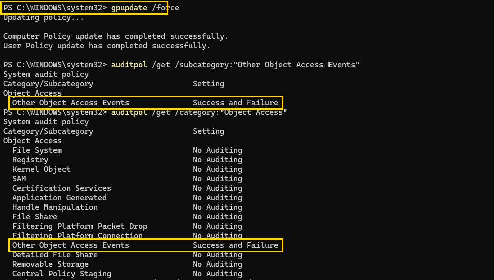
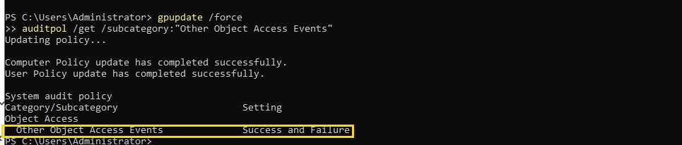

# Audit Policy

Applied via **GPO - SOC Advanced Audit Policy** (domain root) and **GPO - SOC Audit Test** (WORKSTATIONS). Advanced Audit Policy is used rather than the legacy "Audit object access" setting, which is ignored once advanced subcategories are in force and would also enable noisy file/registry auditing.

## Effective settings (verified with `auditpol` on both hosts)

| Category | Subcategory | Setting | Events | Used by |
|---|---|---|---|---|
| Logon/Logoff | Logon | Success, Failure | 4624, 4625 | Failed logons, failed-then-success |
| Logon/Logoff | Account Lockout | Success | 4625 (lockout status) | Lockout investigation |
| Logon/Logoff | Special Logon | Success | 4672 | Privileged logon context |
| Account Logon | Kerberos Authentication Service | Success, Failure | 4768, 4771 | Kerberos brute force, password spraying |
| Account Logon | Kerberos Service Ticket Operations | Success, Failure | 4769 | Kerberos activity |
| Account Logon | Credential Validation | Success, Failure | 4776 | NTLM authentication |
| Account Management | User Account Management | Success, Failure | 4720, 4722, 4724, 4738, 4740 | **New Account Created**, lockouts |
| Account Management | Security Group Management | Success, Failure | 4728, 4732, 4756 | **Privileged Group Membership Added** |
| Detailed Tracking | Process Creation | Success (+ command line) | 4688 | Process investigation |
| Object Access | **Other Object Access Events** | Success, Failure | 4698, 4699 | **Scheduled Task Creation** |

Command-line capture for 4688 is enabled (`ProcessCreationIncludeCmdLine_Enabled = 1`).

All other Object Access subcategories (File System, Registry, etc.) are deliberately left at *No Auditing* to avoid volume without detection value.

## Verification

Windows 11 — after `gpupdate /force`:

DC01 — after `gpupdate /force`:

Why this verification matters: [finding 1](../findings/01-audit-policy-reset-by-gpo.md).
