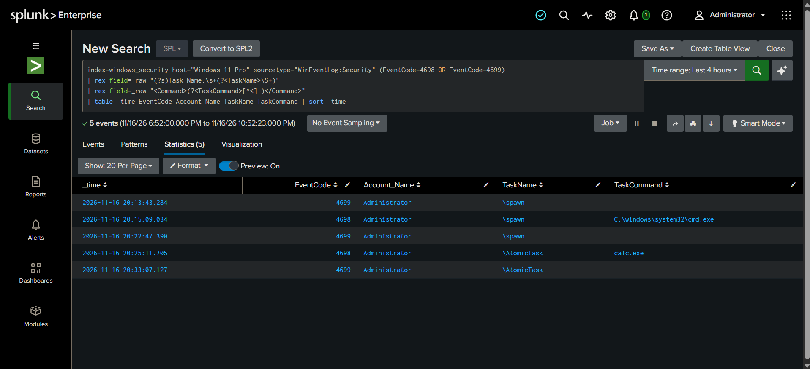
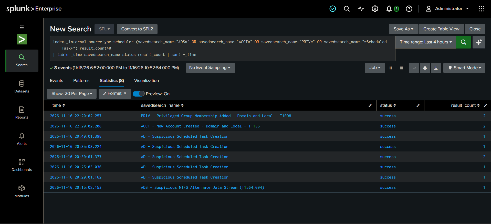

# Scheduled Task Creation — T1053.005

**Why it matters:** scheduled tasks are one of the most common persistence mechanisms — they let malware re-launch on boot or logon.

## Validation — two creation methods

| Test | Method | 4698 logged | Alert fired |
|---|---|---|---|
| T1053.005-2 | `schtasks.exe /Create /TN spawn ...` | 20:15:09 | 20:20:01 |
| T1053.005-4 | PowerShell `Register-ScheduledTask AtomicTask` (no `schtasks.exe`) | 20:25:11 | 20:30:01 |

Testing both matters: a rule keyed on the `schtasks.exe` process would miss method 2 entirely. Because this detection uses the Windows audit event (4698) rather than the process name, it caught both.

## Full task lifecycle in Splunk

| Time (IST) | Event | Task | Meaning |
|---|---|---|---|
| 20:09:45 | — | `\spawn` | First test run — **no 4698** (audit gap, see [finding 1](../../findings/01-audit-policy-reset-by-gpo.md)) |
| 20:13:43 | 4699 | `\spawn` | Cleanup after audit was enabled |
| 20:15:09 | 4698 | `\spawn` → `cmd.exe` | Re-test: created ✅ |
| 20:22:47 | 4699 | `\spawn` | Cleaned up |
| 20:25:11 | 4698 | `\AtomicTask` → `calc.exe` | PowerShell method: created ✅ |
| 20:33:07 | 4699 | `\AtomicTask` | Cleaned up |

## Alert runs

The repeated `result_count` values between 20:20 and 20:40 are the duplicate-alerting problem described in [finding 2](../../findings/02-duplicate-alerts-window-overlap.md), fixed at 20:54.
