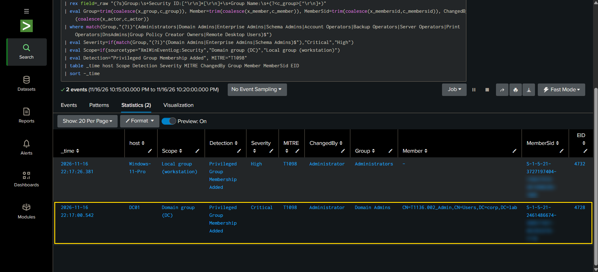
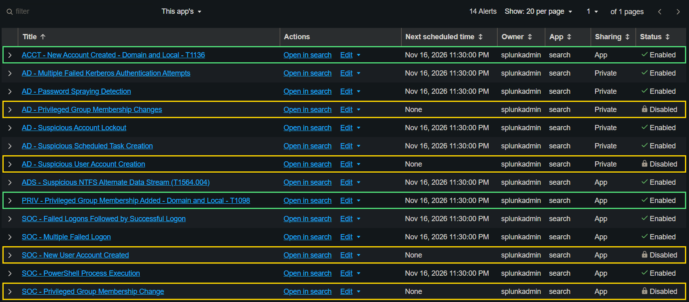

# Privileged Group Membership Added — T1098

**Why it matters:** adding an account to Domain Admins is effectively full control of the domain. It is one of the highest-value events a SOC can alert on.

## Design
- Covers **global (4728), local (4732) and universal (4756)** group changes on **both** the DC and endpoints.
- Alerts **only on privileged groups** — ordinary group changes are ignored, keeping the alert high-signal.
- **Severity tiering**: changes to Domain / Enterprise / Schema Admins are **Critical**; other privileged groups are **High**.

## Validation

The same two Atomic tests used for [account creation](../T1136-account-created/) also add the new account to a privileged group. One scheduled run (22:20:02 IST) caught both:

| Time | Host | Group | Severity | Member |
|---|---|---|---|---|
| 22:17:00 | DC01 | **Domain Admins** | **Critical** | `CN=T1136.002_Admin,CN=Users,DC=corp,DC=lab` |
| 22:17:26 | WINDOWS-11-PRO | Administrators | High | *(local accounts are recorded by SID, not name)* |

> Local group events record the member by security identifier (SID) rather than name — the `MemberSid` field is kept so the analyst can resolve it. SIDs are partially redacted in the screenshot.

## Replacing the old alerts

The four old half-coverage alerts (yellow) were **disabled, not deleted**, preserving their trigger history as evidence. The two new combined alerts (green) replace them.
