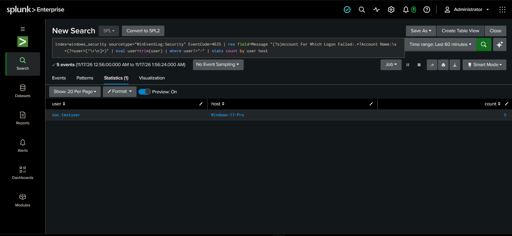

# Multiple Failed Logon (endpoint) — T1110

**Why it matters:** not every credential attack goes through the domain controller. Logons that terminate on a **workstation** — local accounts, interactive sign-ins, some network logons — are evaluated by that host's own LSA and logged as **4625 on the endpoint**. This detection watches that vantage point, which the DC-side Kerberos rule can't see.

## The subtlety that defined the whole validation

A failed logon lands in **different places depending on the authentication protocol**:

| Attack path | Protocol | Where the failure is logged |
|---|---|---|
| `net use \\DC01\IPC$` (by hostname) | Kerberos | **4771 `0x18` on DC01** — endpoint sees nothing |
| `net use \\host` by IP, LDAP bind | NTLM | 4776 / 4625 on the authenticating server |
| Local/interactive logon on the host | MSV1_0 (local) | **4625 on the workstation** ← *this detection* |

So this rule can only be driven by a logon that the **workstation's own LSA** processes. Every standard T1110 atomic authenticates against the DC, so **none of them produce the event this rule needs**. That isn't a flaw in the atomics or the rule — it's a property of how Windows sources authentication events, and recognising it is the point of [finding 4](../../findings/04-endpoint-alerts-not-art-drivable.md).

## Detection logic

```spl
sourcetype="WinEventLog:Security" EventCode=4625     ← classic format, workstation
| bin _time span=10m
| stats count as failed_attempts by _time host target_user source_ip
| where failed_attempts >= 5
```

## Validation — a direct local logon

Since no atomic fits, the failed logons were generated with a **`LogonUser` P/Invoke** (Win32 `advapi32!LogonUser`, logon type **2 = INTERACTIVE**) on WINDOWS-11-PRO. A bad password produces a local **4625**; it needs no SMB, no seclogon service, and no interactive-logon rights.

```powershell
$sig = @'
[DllImport("advapi32.dll", SetLastError=true)]
public static extern bool LogonUser(string user, string domain, string pass,
  int logonType, int logonProvider, out IntPtr token);
'@
$t = Add-Type -MemberDefinition $sig -Name L -Namespace W -PassThru
$tok=[IntPtr]::Zero
1..5 | ForEach-Object { $t::LogonUser("soc.testuser",".","WrongPass$_",2,0,[ref]$tok) }  # 2 = INTERACTIVE
```

→ 5× local 4625 inside one 10-minute bin → alert fired **01:00:01 IST**.


*5× 4625 for `soc.testuser` on `Windows-11-Pro` — the local logons the DC-side Kerberos rule can't see.*

> **Why not loopback `net use \\WINDOWS-11-PRO`?** That still goes Kerberos → the DC, so it produced **zero** events on the workstation. `LogonUser` is what forces the logon through the local LSA.

## Throttling

Unlike the AD alerts, this one **has** throttling configured (`alert.suppress=true`, period `10m`), so a single burst doesn't re-alert on every run.
