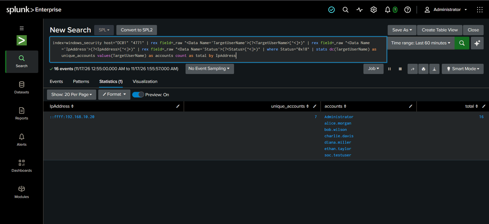

# Password Spraying — T1110.003

**Why it matters:** password spraying is the quieter cousin of brute force. Instead of many guesses against one account (which trips lockout), the attacker tries **one** common password against **many** accounts, staying under each account's lockout threshold. It's a leading technique for initial access and is easy to miss if you only count failures per user.

## Detection logic — breadth, not depth

Same base events as the [Kerberos brute-force detection](../T1110.001-kerberos-brute-force/) (4771 `0x18` on DC01), but pivoted:

```spl
| stats dc(TargetUserName) as unique_accounts
        values(TargetUserName) as targeted_accounts
        count as total_failures
        by IpAddress
| where unique_accounts >= 5
```

| Detection | Counts | Crosses threshold when… |
|---|---|---|
| Brute force (T1110.001) | failures **per user** | one account sees ≥ 5 bad passwords |
| **Spraying (T1110.003)** | **distinct users** per source IP | one source hits ≥ 5 different accounts |

`values(TargetUserName)` lists the sprayed accounts right in the alert, so the analyst sees the scope immediately.

## Validation

Validated with **Atomic Red Team T1110.003-1**, "Password Spray all Domain Users":

```powershell
Invoke-AtomicTest T1110.003 -TestNumbers 1 -ShowDetails
Invoke-AtomicTest T1110.003 -TestNumbers 1 -GetPrereqs   # builds %temp%\users.txt from `net user /domain`
Invoke-AtomicTest T1110.003 -TestNumbers 1
Invoke-AtomicTest T1110.003 -TestNumbers 1 -Cleanup
```

The atomic tries a single password against **every** domain user via `net use` (one attempt each → Kerberos → 4771 `0x18`, no lockouts). The detection counted **6 distinct accounts** from `192.168.10.20` (WINDOWS-11-PRO) and fired at **01:15:01 IST**.


*`stats dc(TargetUserName) by IpAddress` — one source (`192.168.10.20`) hitting every domain account.*

> **Why this atomic?** The other T1110.003 tests use LDAP bind attempts (which log as NTLM → 4776/4625, not 4771 `0x18`), require RSAT, or reach out to the internet. **Test 1 is the only clean match** for a 4771-`0x18`, DC-side detection. Reviewing `-ShowDetails` before running is what surfaced this.

## Known limitation

Like the other AD threshold alerts, this one has **no throttling** — see [finding 5](../../findings/05-ad-alerts-no-throttling.md).
