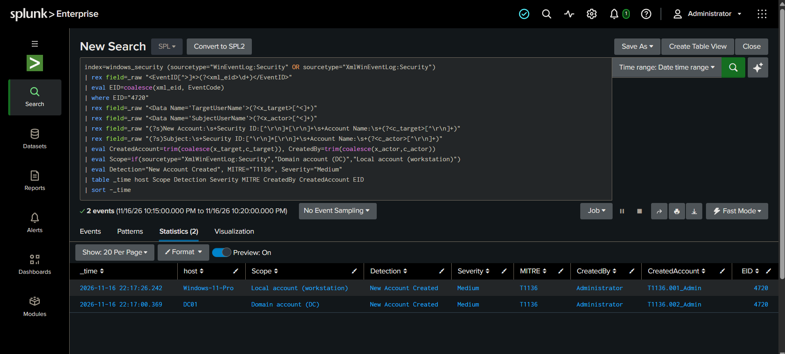
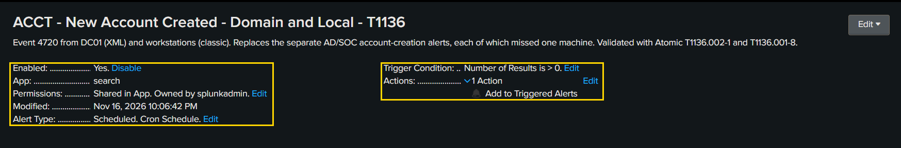

# New Account Created (Domain & Local) — T1136

**Why it matters:** creating a new account is a classic way for an attacker to keep access — on the domain controller (domain account) or on a single endpoint (local account).

## The problem this detection solves

The lab originally had two alerts for this: an "AD" alert that only parsed the DC's XML events, and a "SOC" alert that only parsed the workstation's classic events. Testing proved each one was blind to the other host — see [finding 3](../../findings/03-split-log-formats-blind-alerts.md). This detection replaces both.

## How it handles both formats

```spl
| rex field=_raw "<EventID[^>]*>(?<xml_eid>\d+)</EventID>"   ← XML (DC01)
| eval EID=coalesce(xml_eid, EventCode)                       ← falls back to classic field
```

The same `coalesce()` pattern normalises the creator and new-account names, and a `Scope` field tells the analyst immediately whether it's a domain or local account.

## Validation

Two attacks run back-to-back, one per host:

```powershell
Invoke-AtomicTest T1136.002 -TestNumbers 1   # domain admin user via net user /domain
Invoke-AtomicTest T1136.001 -TestNumbers 8   # local admin user via net user /add
```

One scheduled run (22:20:02 IST) caught **both**:



| Time | Host | Scope | Created by | New account |
|---|---|---|---|---|
| 22:17:00 | DC01 | Domain account (DC) | Administrator | `T1136.002_Admin` |
| 22:17:26 | WINDOWS-11-PRO | Local account (workstation) | Administrator | `T1136.001_Admin` |

Alert configuration:



Both test accounts were deleted afterwards and verified with `net user`.
