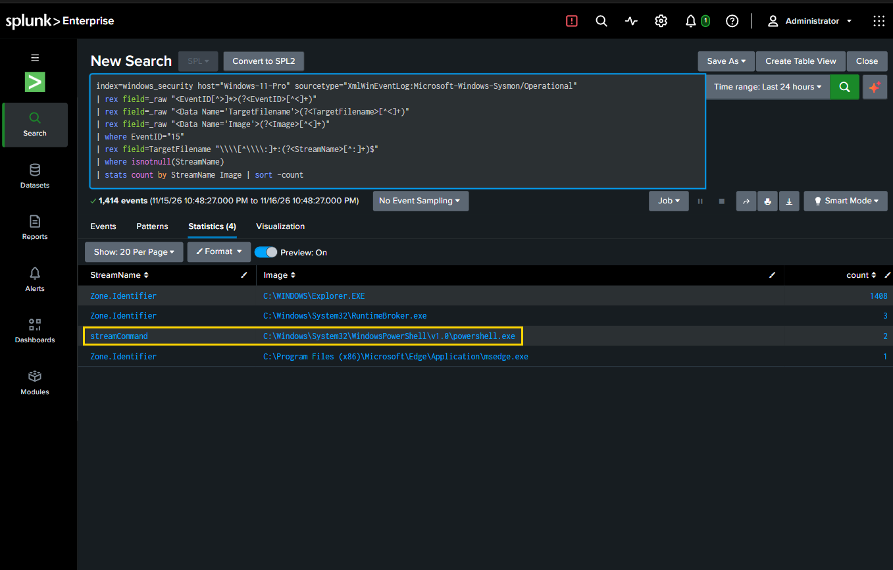
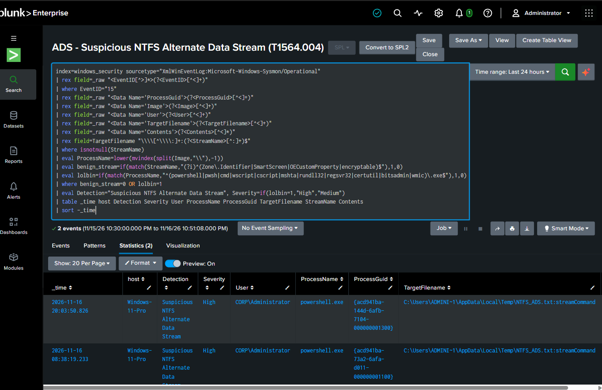

# Suspicious NTFS Alternate Data Stream — T1564.004

**Why it matters:** attackers hide payloads in NTFS alternate data streams (`file.txt:hidden`) because the content is invisible in Explorer and `dir`. Sysmon Event 15 records stream creation.

## 1. Baseline first

Before writing the rule I measured what "normal" ADS activity looks like over 24 hours:



| Stream | Written by | Count (24h) | Verdict |
|---|---|---|---|
| `Zone.Identifier` | Explorer.exe | 1,408 | Benign — Windows "downloaded from internet" marker |
| `Zone.Identifier` | RuntimeBroker.exe | 3 | Benign |
| `Zone.Identifier` | msedge.exe | 1 | Benign |
| **`streamCommand`** | **powershell.exe** | **2** | **The attack** |

A naive "alert on every ADS" rule would have fired ~1,400 times a day. Baselining reduced that to **zero false positives** while still catching the attack.

> **Gotcha fixed during build:** the first stream-name regex also matched the drive-letter colon in `C:\`, producing fake "streams" like `\AtomicRedTeam\...`. The final regex only captures text after a colon that follows a filename.

## 2. Attack

```powershell
Invoke-AtomicTest T1059.001 -TestNumbers 11   # writes and executes a command hidden in an ADS
```

## 3. Detection result



Both test runs detected — **High** severity because the stream was written by `powershell.exe`, with user (`CORP\Administrator`), `ProcessGuid` for correlation with Sysmon Event 1, the full path `NTFS_ADS.txt:streamCommand`, and the hidden contents (`Write-Host "Stream Data Executed"`).

The scheduled alert fired at **20:15:02 IST** for the 20:03 test (see [`11-triggered-alerts`](../../evidence/11-triggered-alerts.png)).

## MITRE mapping note
The Atomic test lives under T1059.001 (PowerShell) because that's how it *executes*. The detection triggers on the *behaviour* — hiding data in an ADS — regardless of which tool does it, so it is mapped to **T1564.004**.
