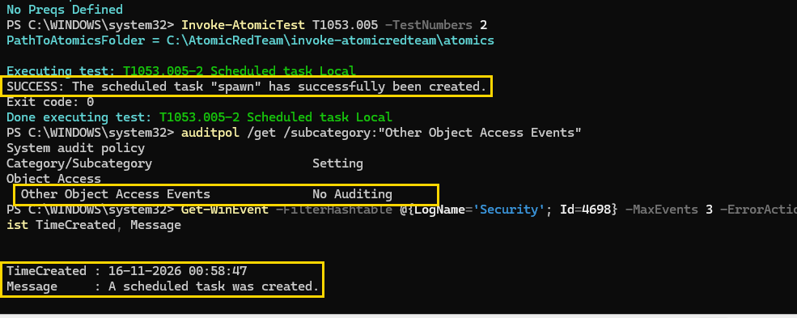
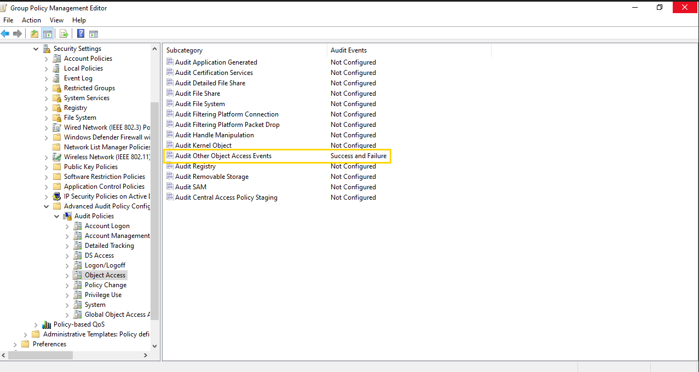

# Finding 1 — Group Policy refresh silently disabled scheduled-task auditing

| | |
|---|---|
| **Impact** | Scheduled-task creation (T1053.005) completely undetectable by the Security-log alert |
| **Found by** | Atomic T1053.005-2 — attack succeeded, alert never fired |
| **Status** | ✅ Fixed and verified on both hosts |

## Symptom
At 20:09:45 IST the scheduled-task test ran successfully. Sysmon recorded `schtasks.exe` executing, but Splunk received **no Event 4698**, so the scheduled-task alert had nothing to fire on.

## Investigation
Traced the missing event backwards, one layer at a time:

1. **Splunk** — Security events *were* arriving from the workstation (321 in the same 20-minute window), so the forwarder was fine. Only 4698 was missing.
2. **Windows Event Log** — `Get-WinEvent -Id 4698` showed the newest 4698 was from **00:58:47** the night before. Windows wasn't writing the event at all.
3. **Audit policy** — `auditpol` showed *Other Object Access Events* = **No Auditing**.

## Root cause
The setting had been enabled **locally** in an earlier session (which is why a 4698 existed at 00:58). A subsequent **Group Policy refresh** re-applied the domain's advanced audit policy — which didn't include this subcategory — and silently reset it to *No Auditing*. Local audit changes don't survive GPO enforcement.

## Fix
Configured *Audit Other Object Access Events = Success and Failure* **centrally in Group Policy** (in both `GPO - SOC Advanced Audit Policy` at the domain root and `GPO - SOC Audit Test` on WORKSTATIONS).

## Verification
- `gpupdate /force` + `auditpol` on **Windows 11** → Success and Failure ([screenshot](../evidence/09-auditpol-after-gpupdate.png))
- `gpupdate /force` + `auditpol` on **DC01** → Success and Failure ([screenshot](../evidence/20-dc01-auditpol-after-gpupdate.png))
- Re-ran the attack → 4698 at **20:15:09**, alert fired at **20:20:01** ([lifecycle](../evidence/03-scheduled-task-lifecycle.png))

## Lesson
A detection is only as reliable as the logging underneath it. Audit configuration must be managed centrally and **re-verified after policy refreshes**; a single local change can look fixed and then quietly revert.
