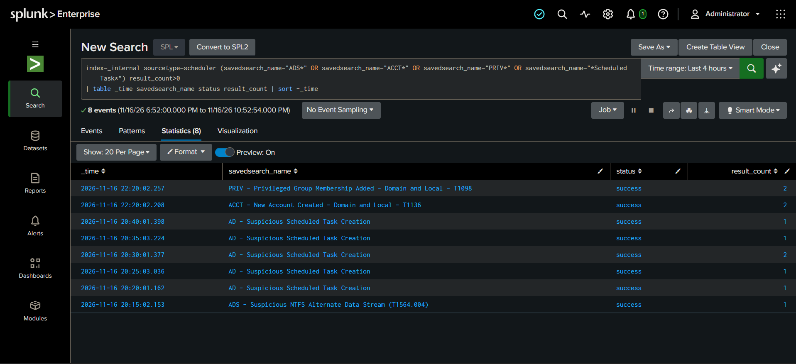

# Finding 2 — Overlapping search windows caused duplicate alerts

| | |
|---|---|
| **Impact** | One malicious event raised up to 3 alerts → analyst fatigue, inflated metrics |
| **Found by** | Reviewing scheduler results after the scheduled-task tests |
| **Status** | ✅ Fixed on the scheduled-task alert; applied to all new single-event alerts |

## Symptom
The single `\spawn` task created at 20:15:09 appeared in three consecutive alert runs:

| Alert run | Results | Contained |
|---|---|---|
| 20:20 | 1 | `\spawn` |
| 20:25 | 1 | `\spawn` again |
| 20:30 | 2 | `\spawn` again + `\AtomicTask` |
| 20:35, 20:40 | 1, 1 | `\AtomicTask` again |

## Root cause
Two problems stacked:
1. The alert ran **every 5 minutes** but its time range was **the last 15 minutes**, so every event fell into three consecutive runs.
2. The SPL itself began with `index=windows_security earliest=-15m`. **An inline `earliest` overrides the alert's configured time range**, so fixing the time range alone would have changed nothing.

## Fix
- Alert time range set to `-5m@m` → `@m` (snapped to the minute, so windows tile exactly with no gaps or overlaps).
- Removed `earliest=-15m` from the search text.
- Verified the saved configuration via Splunk's REST endpoint (`| rest /servicesNS/-/search/saved/searches`).

## Design rule adopted
- **Single-event detections** (account created, group change, task created): window = schedule.
- **Threshold detections** (password spraying, brute force): keep a longer window on purpose so slow attacks still cross the threshold — and control duplicates with **throttling** instead.

All new alerts in this repo follow this rule — see the [alert inventory](../evidence/13-old-alerts-disabled.png).
