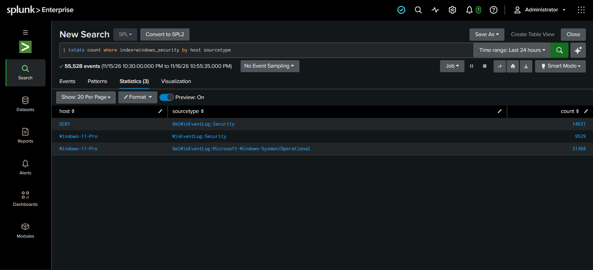
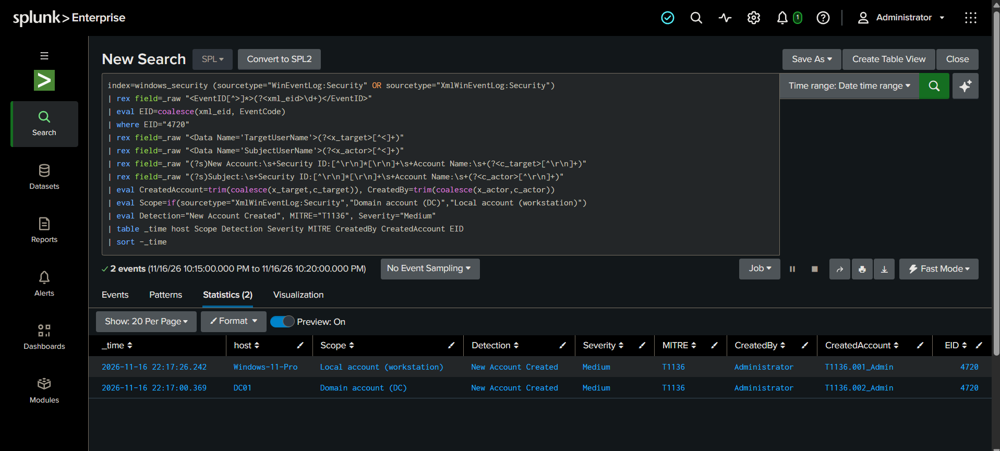
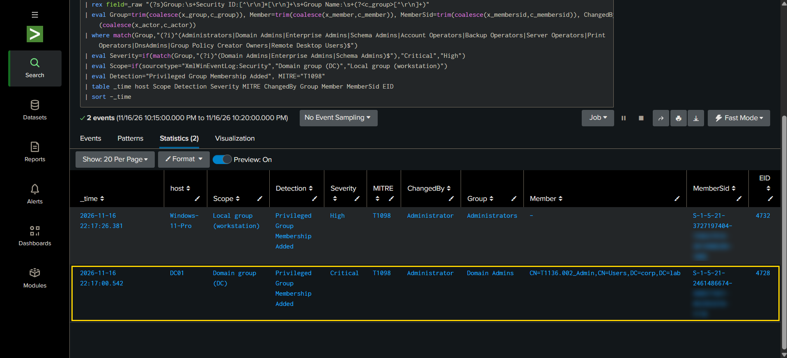

# Finding 3 — Two log formats left each alert set blind to half the environment

| | |
|---|---|
| **Impact** | A **Domain Admin** account created on the DC was missed by one alert set; a local admin created on the workstation was missed by the other |
| **Found by** | Running the same attack type on each host (T1136.002 on DC, T1136.001 on workstation) |
| **Status** | ✅ Fixed — 4 half-coverage alerts replaced by 2 full-coverage alerts |

## Symptom
The lab had two pairs of overlapping alerts ("AD -" and "SOC -") for account creation and privileged-group changes. They looked like harmless duplicates. Testing showed they were actually **complementary halves**:

| Attack | "AD -" alerts | "SOC -" alerts |
|---|---|---|
| T1136.002 — domain admin created on **DC01** (21:47) | ✅ fired | ❌ **0 results** |
| T1136.001 — local admin created on **workstation** (21:53) | ❌ only `host="DC01"` | ✅ fired |

## Root cause
The two hosts send their Security logs in different formats:



| Host | Sourcetype | Event ID appears as |
|---|---|---|
| DC01 | `XmlWinEventLog:Security` | `<EventID>4720</EventID>` |
| WINDOWS-11-PRO | `WinEventLog:Security` | `EventCode=4720` |

- The "AD -" alerts filtered `host="DC01"` and parsed XML.
- The "SOC -" alerts filtered `sourcetype="WinEventLog:Security"` and parsed the classic `Message` text.

Each was correct for one host and silently blind to the other.

## Fix
Built two new alerts that **normalise both formats** and search both hosts:

```spl
index=windows_security (sourcetype="WinEventLog:Security" OR sourcetype="XmlWinEventLog:Security")
| rex field=_raw "<EventID[^>]*>(?<xml_eid>\d+)</EventID>"
| eval EID=coalesce(xml_eid, EventCode)
```

- [ACCT - New Account Created - Domain and Local - T1136](../detections/T1136-account-created/)
- [PRIV - Privileged Group Membership Added - Domain and Local - T1098](../detections/T1098-privileged-group-added/)

The four old alerts were **disabled (not deleted)** to preserve their trigger history.

## Verification
Re-ran both attacks back-to-back (22:17). The 22:20 run of each new alert returned **2 results — one per host**:




## Lesson
Duplicate-looking detections aren't necessarily redundant — and an alert that has never fired against a given host shouldn't be assumed to cover it. **Test each detection against each host type it claims to cover.**

## Remaining work
The scheduled-task detection still parses only the classic format, so it covers the workstation but not DC01. It's on the [roadmap](../docs/roadmap.md) to be converted to the same pattern.
