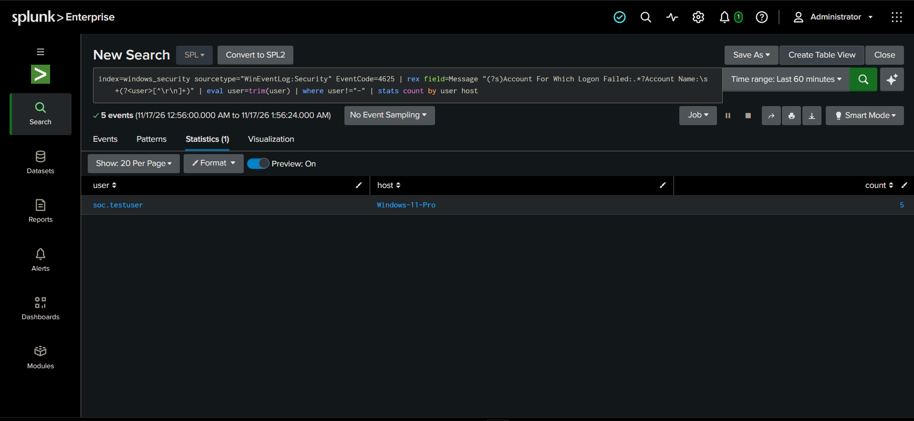

# Finding 4 — Two endpoint alerts can't be driven by standard brute-force atomics

| | |
|---|---|
| **Impact** | Two detections (`SOC - Multiple Failed Logon`, `SOC - Failed Logons Followed by Successful Logon`) would have been marked "can't validate" if driven only by Atomic Red Team — or, worse, assumed working without proof |
| **Found by** | Running T1110 atomics against the lab and seeing **zero** events reach the detections, then tracing why |
| **Status** | ✅ Understood and worked around — validated with a `LogonUser` local-logon simulation; rule logic confirmed correct |

## Symptom

The two SOC logon detections read **Event 4625 on the workstation** (`sourcetype=WinEventLog:Security`, classic format). Every attempt to feed them with a T1110 atomic — or a plain `net use \\HOST\IPC$` with a bad password — produced **nothing on the workstation**. The failures appeared only on the **domain controller** as 4771.

## Root cause — where a failed logon lands depends on the auth protocol

This is not a bug in the atomics or the detections. It's how Windows sources authentication events:

| Attack path | Protocol | Failure event & host |
|---|---|---|
| `net use \\DC01\IPC$` (by hostname) | **Kerberos** | **4771 `0x18` on DC01** (AS-REQ pre-auth). The target host never sees it. |
| `net use \\10.0.0.x` (by IP) / LDAP bind | NTLM | 4776 / 4625 on the authenticating server |
| Logon processed by the **workstation's own LSA** | MSV1_0 (local) | **4625 on the workstation** |

Standard T1110 atomics (and `net use` by hostname) authenticate against the **DC** → Kerberos → 4771. So they can exercise the DC-side [Kerberos brute-force](../detections/T1110.001-kerberos-brute-force/) and [spraying](../detections/T1110.003-password-spraying/) detections, but they can **never** produce the workstation-local 4625 the two SOC rules are built on. Even a loopback `net use \\WINDOWS-11-PRO` went Kerberos → DC and produced zero events locally.

## Fix / work-around — drive the endpoint directly with LogonUser

To get a workstation-local 4625, the logon has to be processed by that host's LSA. A direct **`LogonUser` P/Invoke** (Win32 `advapi32!LogonUser`, logon type **2 = INTERACTIVE**) does exactly that — no SMB, no seclogon service, no interactive-logon rights required:

```powershell
$sig = @'
[DllImport("advapi32.dll", SetLastError=true)]
public static extern bool LogonUser(string user, string domain, string pass,
  int logonType, int logonProvider, out IntPtr token);
'@
$t = Add-Type -MemberDefinition $sig -Name L -Namespace W -PassThru
$tok=[IntPtr]::Zero
$t::LogonUser("soc.testuser",".","<correct>",2,0,[ref]$tok)                 # -> 4624 (good)
1..5 | ForEach-Object { $t::LogonUser("soc.testuser",".","WrongPass$_",2,0,[ref]$tok) }   # -> 4625 (bad)
```

- `SOC - Multiple Failed Logon` → 5 bad calls → 5× local 4625 → fired **01:00:01 IST**.
- `SOC - Failed Logons Followed by Successful` → 1 good call then 5 bad, same 10-minute bin → fired **01:00:00 IST**.


*The workstation-local 4625 events a DC-authenticating atomic never produces.*

## Why this matters (the interview talking point)

A detection is only as good as your understanding of **what sources its events**. Marking these rules "validated" off a Kerberos atomic would have been wrong — the atomic never touches the code path the rule watches. Choosing the validation method requires knowing the difference between Kerberos, NTLM and local authentication, and which of 4771 / 4776 / 4625 each one writes, and on **which host**. The honest outcome: *use an atomic where one genuinely fits the event source, and a documented manual simulation where it doesn't.*

## Design rule adopted

> Before validating a detection, confirm the **event source** (which host, which log, which auth protocol) and pick a simulation that exercises **that exact path** — not merely the same MITRE technique.
