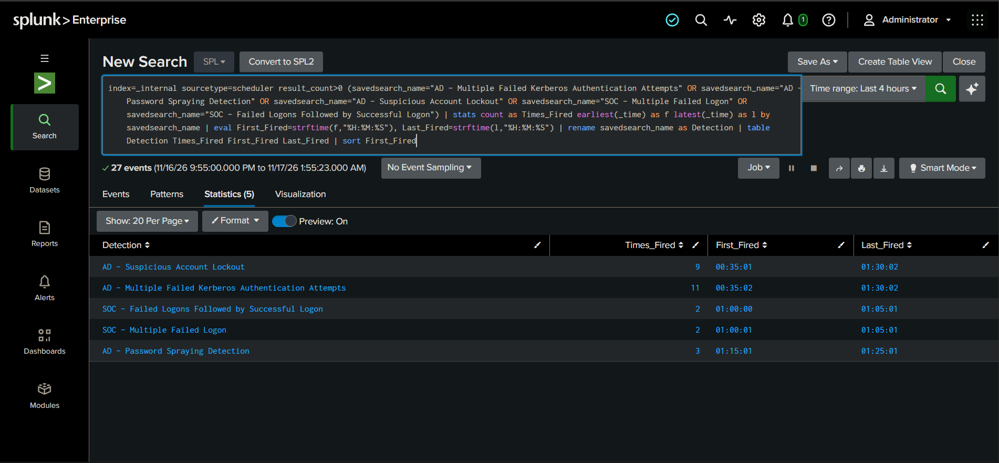

# Finding 5 — The AD threshold alerts have no throttling, so one incident re-alerts for 15 minutes

| | |
|---|---|
| **Impact** | A single brute-force / spray / lockout incident raises a fresh alert on **every 5-minute run** until its events age out — up to ~3 duplicate alerts per incident, inflating metrics and causing analyst fatigue |
| **Found by** | Reviewing `index=_internal sourcetype=scheduler` while validating the five new T1110 detections |
| **Status** | ⚠️ Diagnosed, fix specified and ready to apply — the SOC equivalents already carry the fix |

## This is Finding 2, re-opened for the AD alert set

[Finding 2](02-duplicate-alerts-window-overlap.md) fixed duplicate alerts for the **single-event** detections by snapping their window to the schedule (`-5m@m`→`@m`). It also recorded the rule for **threshold** detections:

> Threshold detections (spraying, brute force) keep a longer window on purpose so slow attacks still cross the threshold — and control duplicates with **throttling** instead.

When the three AD threshold alerts were validated this session, the scheduler history showed that second half — the **throttling** — had never actually been configured on them. The design rule was written down but not applied.

## Evidence

All three AD alerts have `alert.suppress = false` (confirmed via the REST `saved/searches` endpoint). On a **5-minute schedule** over a **15-minute window**, each triggering event sits in three consecutive runs. Two test incidents (a manual brute force ~00:35 and the Atomic Red Team re-run ~01:17) produced this:

| Alert | Fired at (IST) | Distinct incidents |
|---|---|---|
| `AD - Multiple Failed Kerberos` | 00:35, 00:40, 00:45, 00:50, 00:55, 01:00, 01:05, 01:10, 01:20, 01:25 | **2** |
| `AD - Suspicious Account Lockout` | 00:35, 00:40, 00:45, 01:00, 01:05, 01:10, 01:20, 01:25 | **2** |
| `AD - Password Spraying` | 01:15, 01:20, 01:25 | **1** |

One password-spray test → **three** alerts. One brute-force burst → **up to eight** (it also keeps re-counting as new `0x18` events arrive). Every row after the first for a given incident is noise.


*Scheduler fire counts: the un-throttled AD alerts (11, 9, 3) dwarf the throttled SOC alerts (1, 1) off the same handful of incidents.*

By contrast the two SOC logon alerts, which **do** have `alert.suppress=true` (period `10m`), each fired **once** per incident.

The cumulative triggered-alert counts (Splunk `services/alerts/fired_alerts`) make the gap plain — the AD alerts rack up triggers from only a couple of test incidents, while the throttled SOC alerts stay at 1:

| Alert | `alert.suppress` | Triggered-alert count | Incidents |
|---|---|---|---|
| `AD - Multiple Failed Kerberos` | ❌ false | **11** | 2 |
| `AD - Suspicious Account Lockout` | ❌ false | **9** | 2 |
| `AD - Password Spraying` | ❌ false | **3** | 1 |
| `SOC - Multiple Failed Logon` | ✅ 10m | **1** | 1 |
| `SOC - Failed → Successful Logon` | ✅ 10m | **1** | 1 |

## Root cause

`alert.suppress` was never enabled on the AD alerts. A longer-than-schedule window is correct for threshold detection (slow attacks still cross the line), but without suppression the same crossing re-reports every run until it ages out.

## Fix (specified)

Enable per-entity throttling on each of the three AD alerts:

```ini
alert.suppress = 1
alert.suppress.period = 15m          # >= the search window, so an incident alerts once
alert.suppress.fields = TargetUserName        # brute force / lockout: throttle per account
# AD - Password Spraying:
alert.suppress.fields = IpAddress             # spray: throttle per source
```

- **Brute force / lockout** → suppress on `TargetUserName` (optionally `TargetUserName,IpAddress`), so each *account* alerts once per window but two different victims still alert separately.
- **Spraying** → suppress on `IpAddress`, so each *source* alerts once.

## Validation plan

Re-run the same atomics after applying the fix and confirm each incident produces **exactly one** scheduler fire — then attach a before/after of the scheduler history. (The "before" is already captured above.)

## Design rule reaffirmed

> A threshold detection needs **two** things to behave: a window longer than its schedule *and* throttling (`alert.suppress`) keyed to the entity it counts. One without the other either misses slow attacks or spams duplicates.
